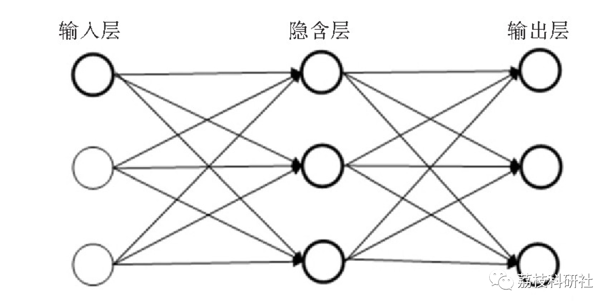
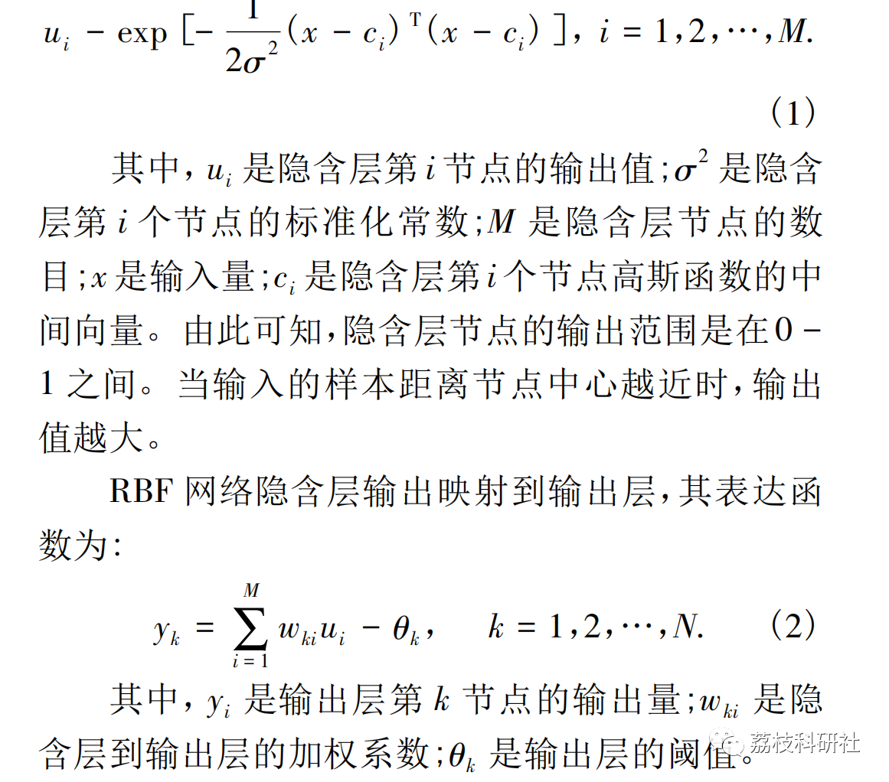
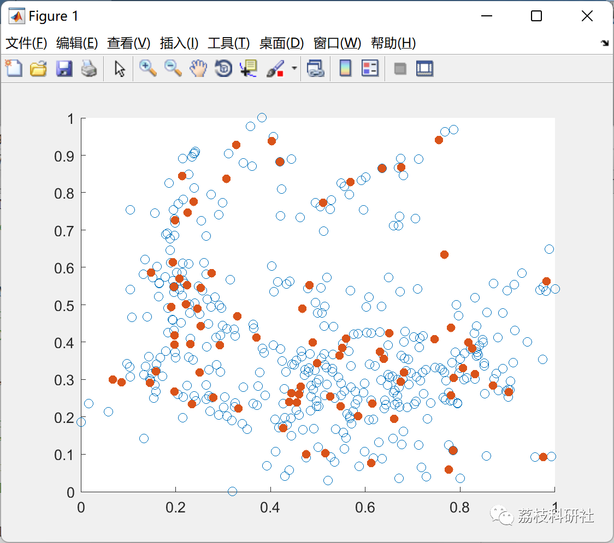

# Optimization of Radial Basis Function Neural Network Based on K-means Clustering (Matlab Code Implementation)

💥💥💥💞💞💞💞 Welcome to this blog❤️❤️❤️💥💥💥
🏆 Bloggers' Advantage: 🌞🌞🌞 The content of the blog strives to be rigorous in thought and clear in logic, for the convenience of readers.
⛳️ Mantra: The journey of a hundred miles is half done in the last ninety.
Litchi Research Society
Code Collection: Power System, Intelligent Algorithms and Applications, Neural Network Prediction, Path Planning, Optimized Scheduling, Workshop Scheduling, Image Processing, Signal Processing...
🎁Column Directory Link:
🌈🌈🌈🌟🌟🌟Electrical Code Intelligent Algorithm and Its Application Path Planning Neural Network Predictive Optimization Scheduling Image Processing Workshop Scheduling Signal Processing Romantic Her My Philosophical Thoughts Math Modeling Complete Code Matters
💥1 Overview
1.1 Radial Basis Function Neural Network Model
The Radial Basis Function (RBF) neural network is a common three-layer neural network, primarily consisting of an input layer, an implicit layer, and an output layer, as shown in Figure 1. The working principle of the RBF neural network involves using the Radial Basis Function (RBF) as the node function of the second hidden layer, thereby establishing the space of the hidden layer. When data is input into the network, it is passed from the input layer to the hidden layer. After computation by the hidden layer's node function, the data is then passed to the output layer. Typically, the computation function for the hidden layer nodes is nonlinear. As the number of nodes in the hidden layer increases, the number of times data is processed also increases, resulting in more accurate results obtained by the RBF network. However, too many nodes can decrease the efficiency of the network's execution. The node function of the third output layer is typically linear, its role is generally to weight the results of the hidden layer's computations, transforming the data into a format that is easy to output and understand.
In the RBF neural network, let the number of input layer nodes be I, the number of hidden layer nodes be M, and the number of output layer nodes be N. The input quantity x is passed through I times when it is input into the model. Therefore, define x as the 1-dimensional input quantity. Assuming the output quantity is y, similarly, y will undergo N outputs, and this quantity is referred to as the N-dimensional output. Generally, the Gaussian activation function is used as the role function for hidden layer nodes. The output of the i-th node in the RBF network's hidden layer is:
1.2 K-means Clustering Algorithm
The K-means clustering algorithm is currently the most widely used partitioning clustering algorithm. It features simple principles, clear models, convenient operations, and rapid computations. It can perform clustering on a large scale simultaneously for various types of data, quickly extracting hidden relationships and structures within the data.
The K-means clustering algorithm determines the category of data based on the distance to the center point of the data. It divides N objects into k clusters, representing each cluster's centroid (core) with the mean value of the objects in the cluster. By using an appropriate distance calculation formula, it calculates the distance between the data and the cluster centers, and then assigns them to the appropriate clusters. After all data has been clustered, check if the cluster centers have converged. If they have, stop; otherwise, continue iteration.
📚2 Running Results
🎉3 References
[1] Zhang Tianyi, Sun Yuli, Liu Fanqi, Liang Yueqi, Lin Yongjie, Ma Minghui. Traffic flow prediction method based on K-means clustering algorithm and RBF neural network [J]. Intelligent Computer and Applications, 2020, 10(08):148-151.
🌈4 MATLAB Code Implementation
Click the article's lower left corner to "Read More"

## Images

<!-- PAYMENT_BLOCK -->

## Get this dataset

- Payment link (Stripe): [Buy now](https://buy.stripe.com/3cs8yP7sY87d0vu9AB)
- Payment QR code: 

<!-- /PAYMENT_BLOCK -->
